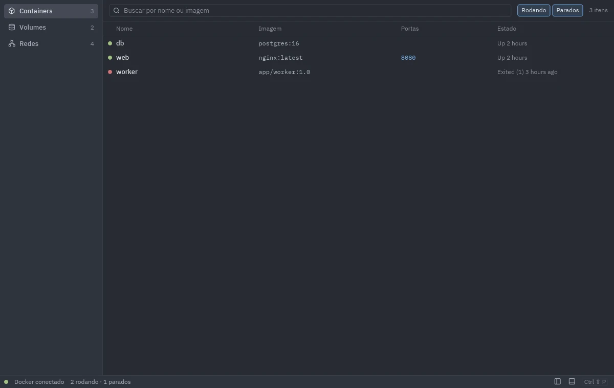
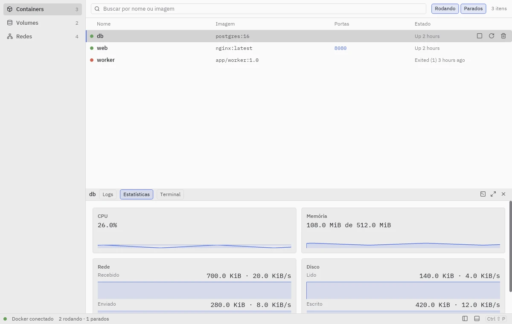
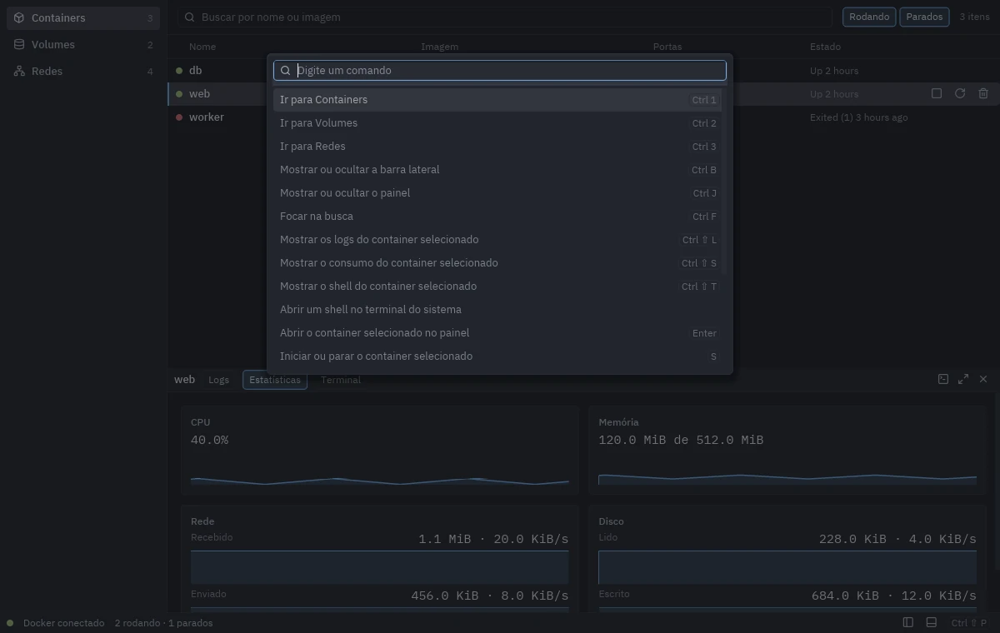
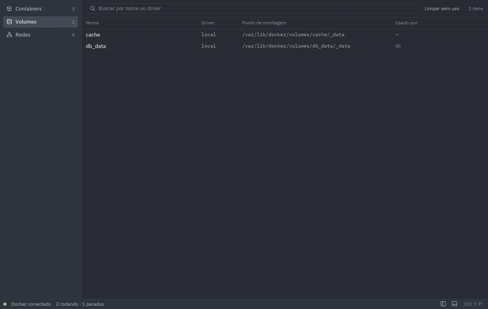
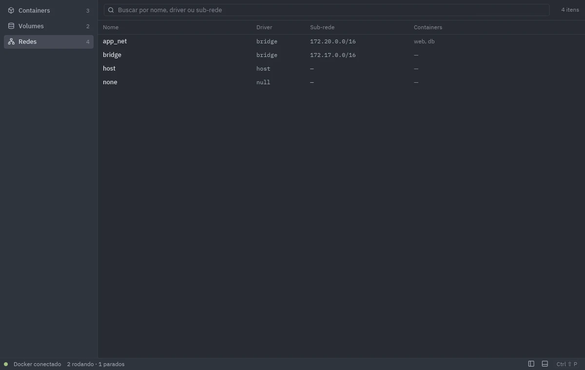

# doknyu

[](https://github.com/RafaelProfMgz/doknyu/actions/workflows/ci.yml)
[](https://github.com/RafaelProfMgz/doknyu/releases/latest)
[](#license)

A fast, keyboard-friendly desktop app for Linux to manage Docker containers, logs, stats, volumes
and networks, with an embedded terminal for each container. Written in Rust
([iced](https://iced.rs) + [bollard](https://github.com/fussybeaver/bollard)). It follows the
system light/dark theme and is available in English and Brazilian Portuguese.

## Screenshots

<!-- The files below live in docs/screenshots/. -->






## Installation

Pick one of the files from the [latest release](https://github.com/RafaelProfMgz/doknyu/releases/latest).
Each release also has a `SHA256SUMS` file: `sha256sum --check --ignore-missing SHA256SUMS`.

**Debian, Ubuntu and derivatives (`.deb`)**

```sh
sudo apt install ./doknyu_<version>-1_amd64.deb    # e.g. doknyu_0.1.0-1_amd64.deb
```

**Any distribution (AppImage, needs FUSE 2: `libfuse2` on Ubuntu 22.04/24.04)**

```sh
chmod +x doknyu-x86_64.AppImage
./doknyu-x86_64.AppImage
```

The AppImage does not bundle Wayland, X11, Vulkan or GL: they come from your system, together with
the GPU driver. Both formats are built on Ubuntu 22.04 (glibc 2.35), so they run on that and anything newer.

### Docker permissions

doknyu talks to the Docker daemon through its socket (`/var/run/docker.sock`, or `DOCKER_HOST` if
set to a `unix://` address). Your user must be allowed to use it:

```sh
sudo usermod -aG docker $USER
```

Then log out and back in. Note that membership in the `docker` group is equivalent to root on the
machine. The terminal tab also needs the `docker` CLI to be installed.

### Uninstalling

Use the command that matches how you installed doknyu. Uninstalling never touches Docker: your
containers, images, volumes and networks stay as they are.

| Installed with | Remove with |
|---|---|
| `.deb` | `sudo apt remove doknyu` |
| AppImage | Delete the `.AppImage` file. If AppImageLauncher or Gear Lever integrated it, remove it from there (or delete its entry in `~/.local/share/applications/`). |
| `cargo install --path .` (from source) | `cargo uninstall doknyu` |

Your preferences live in `~/.config/doknyu` (or `$XDG_CONFIG_HOME/doknyu`); remove that folder too
for a clean uninstall: `rm -rf ~/.config/doknyu`.

Flathub, AUR, COPR and nixpkgs packages are prepared in [`packaging/`](packaging/README.md) but not
published yet; this table gains their rows as each one goes live.

## Keyboard shortcuts

| Keys | Action |
|------|--------|
| `Ctrl+Shift+P` | Command palette (every action, searchable) |
| `Ctrl+1` / `Ctrl+2` / `Ctrl+3` | Containers / Volumes / Networks |
| `Ctrl+B` | Show or hide the sidebar |
| `Ctrl+J` | Show or hide the dock (details panel) |
| `Ctrl+Shift+L` / `S` / `T` | Dock tabs: Logs / Stats / Terminal |
| `Ctrl+F` or `/` | Focus the search field (in the logs tab, search the logs) |
| `j` / `k` or `Down` / `Up` | Select next / previous item |
| `Enter` | Open the selected item |
| `s` / `r` | Start or stop / restart the selected container |
| `Delete` | Remove the selected item (always asks for confirmation) |

The plain-letter shortcuts only work while no text field has focus.

## Contributing

Rust 1.89 or newer. On Ubuntu/Debian, build dependencies are
`libxkbcommon-dev libwayland-dev libvulkan-dev pkg-config`.

```sh
cargo run                    # needs a running Docker daemon
cargo run --features fake    # in-memory fake client, no Docker needed
cargo fmt --check
cargo clippy --all-targets -- -D warnings
cargo test
cargo test -- --ignored      # integration tests, need Docker
```

See [CONTRIBUTING.md](CONTRIBUTING.md). In short: branch off `develop` and open your pull request
**against `develop`**; `main` only accepts pull requests from `develop`.

Every user-visible string goes through `t!("key")` with entries in both `locales/en.yml`
and `locales/pt-BR.yml`. Design and roadmap: [spec](docs/specs/2026-10-29-doknyu-design.md) and
[plan](docs/plans/README.md).

### Building the packages

```sh
cargo build --release
cargo install cargo-deb --locked && cargo deb --no-build   # target/debian/*.deb
packaging/appimage/build-appimage.sh                       # target/appimage/*.AppImage
```

Releases are built by `.github/workflows/release.yml` when a `v*` tag is pushed.

## Português (resumo)

doknyu é um app desktop para Linux que gerencia containers, logs, estatísticas, volumes, redes e
um terminal embutido do Docker. Instale o `.deb` (`sudo apt install ./doknyu_*.deb`) ou o AppImage
da [última release](https://github.com/RafaelProfMgz/doknyu/releases/latest). Para acessar o
Docker, adicione seu usuário ao grupo `docker` (`sudo usermod -aG docker $USER`) e entre na sessão
de novo. Para testar sem Docker: `cargo run --features fake`.

Para desinstalar, use o comando da forma como você instalou (tabela completa em
[Uninstalling](#uninstalling)): `.deb` → `sudo apt remove doknyu`; AppImage → apague o arquivo;
compilado com `cargo install --path .` → `cargo uninstall doknyu`. Flathub, AUR, COPR e nixpkgs
ainda não foram publicados. As preferências ficam em `~/.config/doknyu` (apague para
remover tudo). Seus containers, imagens e volumes do Docker não são afetados.

## License

Licensed under either of [Apache License 2.0](LICENSE-APACHE) or [MIT](LICENSE-MIT), at your option.
